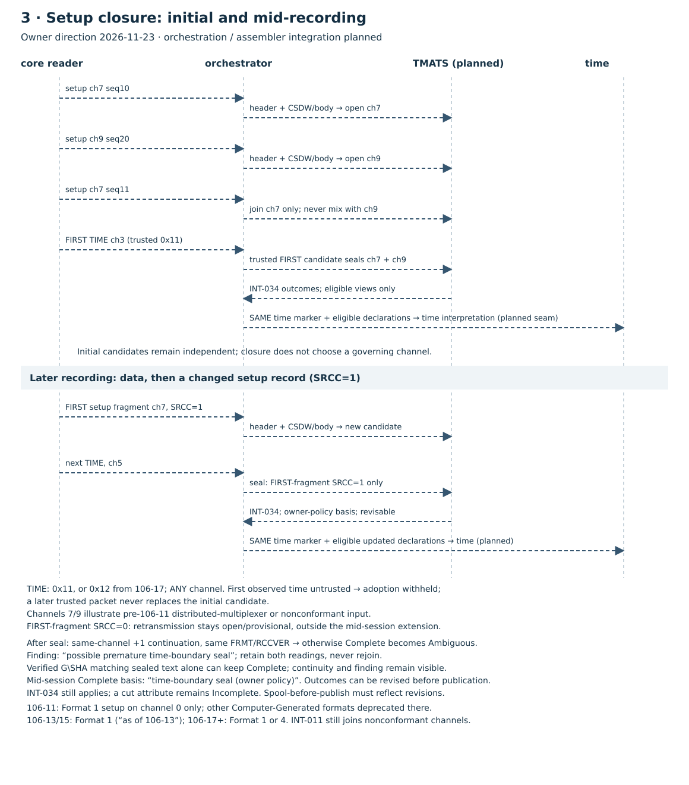
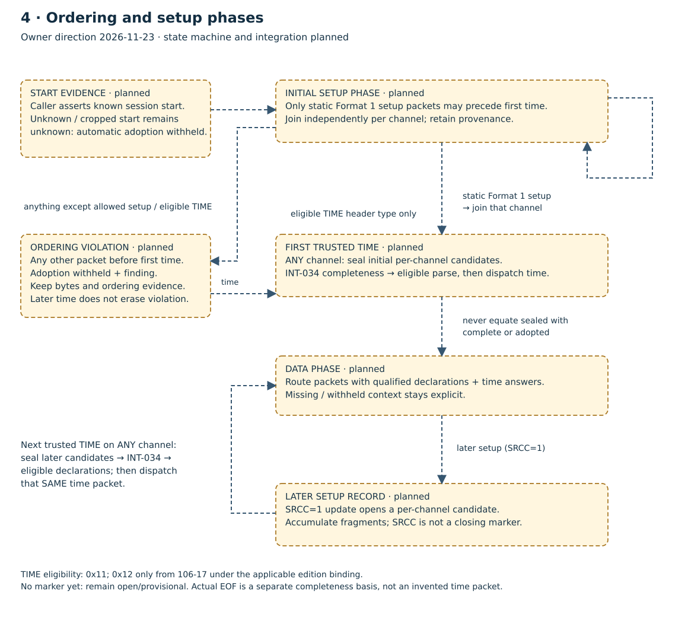
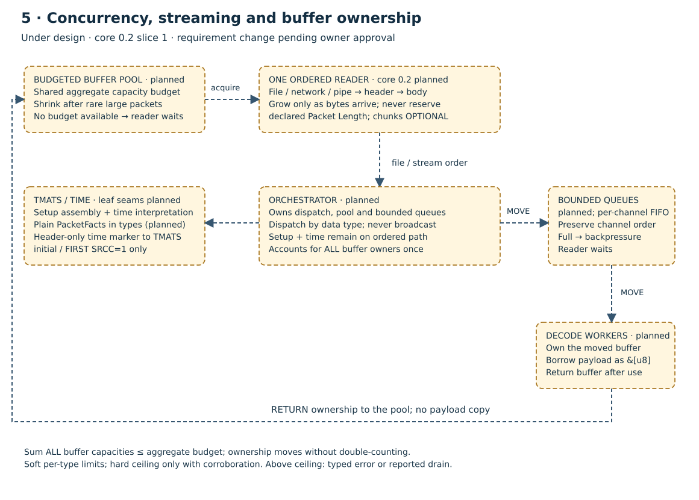

# How the libraries pass information

**Owner-directed architecture, 2026-11-23.** Core 0.1.0 supplies the shared
structural packet reader. The diagrams show the intended ecosystem around it,
not a claim that all integrations are implemented. Every unimplemented consumer,
seam, and orchestration step is labelled **planned**. The older
[implementation snapshot](../implementation.md) remains dated 2026-11-10;
this page does not silently update its historical evidence.

The owner has decided the layer responsibilities, one shared reader, per-channel
setup assembly, initial and mid-recording closure by time packets, and initial
ordering checks. The **coordinator-recommended** one-pass orchestrator is a
planned design. The **owner decision of 2026-11-23** fixes the plain packet-facts type location in
`irig106-types`: core produces the facts, the orchestrator passes them on, and
TMATS consumes them without depending on core. The type and its integration
remain **planned** until implemented.

## 1. Layers and dependencies

[SVG source](diagrams/pipeline-layers.svg) · [PNG export](diagrams/pipeline-layers.png)

The layers are shared values (`irig106-types`), structural reading
(`irig106-core`), meaning (`irig106-tmats`, `irig106-time`, `irig106-decode`),
downstream write/index/validation, and CLI/Studio applications. Dependency arrows
point **from a consumer toward its provider**; they are not the direction of
runtime data flow. Dashed downstream connections show planned consumption, not
newly approved Cargo dependency manifests.

The umbrella `irig106-cli` is intended to mount the time and TMATS CLI libraries
(**planned**). Studio has application code; its integration with this pipeline is
**planned**. `irig106-ch10-reader` is **archived**, outside the target pipeline.
One reader in core is the target: this does not claim every existing consumer
has already removed its duplicate reader.

Time remains a leaf library depending only on types (ADR-0005). The owner-decided
TMATS leaf boundary uses `PacketFacts` (**planned**), a header-facts-only type
in `irig106-types`. The name is diagram notation, not a released API. This
location is decided, not an open option (owner decision, 2026-11-23). Core produces that shared value, the orchestrator passes it on,
and TMATS consumes it. TMATS stays independent of core; the orchestrator does
not define a competing packet-facts type. No direct TMATS-to-core dependency
is selected. Time gains no dependency on core or TMATS. Static dependencies
and runtime calls are distinct: the recommended orchestration below has no
semantic library call another semantic library to walk the recording.

## 2. A single streaming pass

[SVG source](diagrams/pipeline-flow.svg) · [PNG export](diagrams/pipeline-flow.png)

The **planned orchestrator** lives in a CLI application or a future pipeline
crate. It drives one `irig106_core::PacketReader` in **file order**, retaining byte
offsets. It never sorts by RTC before assembly. The owner-approved **planned**
selective dispatch below refines the original all-header forwarding proposal:

1. Classify each packet once from its header data-type byte. Setup packets go
   to TMATS with core-produced plain `PacketFacts` (**planned**), CSDW and body.
   TMATS observes every header **only during the initial setup phase**, so it
   can enforce initial ordering and recognize the first observed time candidate (without skipping an untrusted one).
   `SetupAssembler.observe(...)` is conceptual notation, not a released API.
2. TMATS tracks independent per-channel candidates. An eligible time marker
   notifies TMATS only while a closure-eligible candidate is open: initial setup
   or a later candidate whose **first fragment has SRCC=1**. First-fragment
   SRCC=0 retransmissions remain open/provisional outside the extension. On seal,
   INT-034 assesses completeness separately; eligible
   parsing produces qualified plain declarations and findings (**planned**).
3. Time packets go to time with the qualified declarations. When a packet also
   closes setup, the cheap header-only marker notification and setup assessment
   precede time interpretation of that **same** packet. Its payload is not
   decoded by TMATS or included in setup text.
4. Data packets go only to decode, with qualified declarations and time answers
   (**planned**). After the initial phase, they are not dispatched to TMATS.
   Missing metadata or time basis remains explicit rather than invented.

Core checks framing and exposes integrity evidence, not TMATS validity, time
meaning, or complete standard conformance. Its bounded `body_prefix` can be only
part of DATA: the caller must choose explicit capture and aggregate assembler
budgets, detect insufficient capture, and report typed limits. Never parse a
captured prefix as a complete setup body, silently drop fragments, buffer an
unbounded recording, or add a hidden second reader.

The time-view seam is **planned**, gated by ADR-0021 on full TMATS 0.1 release and
owner approval. A TIMEIN declaration does not establish a data-channel to
time-channel association; that relationship remains unresolved without evidence.
Missing, incomplete, ambiguous, or withheld context stays explicit. No automatic
carry-forward or provisional-use policy is invented here.

## 3. Closure is separate from completeness and adoption

[SVG source](diagrams/pipeline-closure.svg) · [PNG export](diagrams/pipeline-closure.png)

**Owner decisions, 2026-11-23:**

- **Join per channel (INT-011).** Other-channel setup fragments never mix with
  or interrupt a run. Preserve sequence progression, FRMT/RCCVER agreement,
  fragment provenance, and start/stop evidence. The channel-0 restriction from
  106-17 is an independent conformance check, not permission to merge runs.
- **Initial closure (INT-045).** The **first observed TIME candidate** on any
  channel supplies the initial boundary only if it is structurally trusted and
  eligible. If that first candidate is untrusted, adoption is withheld; a later
  trusted candidate **does not replace it** as the initial boundary. The eligible
  header data type is `0x11`, or `0x12` where defined
  from 106-17, under the applicable edition binding. Unknown/reserved types and
  timestamps embedded in other packet bodies are not this signal.
- **Mid-recording closure.** The next eligible trusted time packet closes a
  candidate **only if its FIRST fragment has trusted SRCC=1**. Later fragment
  bits, majority votes, or repeated SRCC=1 bits do not change eligibility or
  restart the candidate. First-fragment SRCC=0 retransmissions stay outside
  this owner extension, open/provisional, even if a later fragment says 1.
- **Header facts suffice for closure.** No time payload decoding, usable clock,
  UTC answer, or time-source selection is needed to recognize the boundary.
  Header/edition trust still matters; corrupt or unreadable bytes are not a
  trusted marker merely because they resemble a type code.

A sealed run is not automatically complete or governing. INT-034 independently
assesses complete/incomplete/ambiguous outcomes. Cut-mid-attribute text is
**Incomplete**, with a located finding, not held open for repair by later text.
Closure cannot choose a governing candidate, fix duplicate/split ambiguity, or
waive normal validity and integrity gates.

**Premature-seal guard (planned implementation).** A same-channel +1 continuation
with the same FRMT/RCCVER after a time-boundary seal makes an otherwise Complete
semicolon-ending candidate **Ambiguous**, with both readings retained and a
located **“possible premature time-boundary seal”** finding naming the seal and
continuation. Never rejoin the sealed and later bytes. If reviewed, unambiguous
`G\SHA` verification **matches the sealed text alone**, that otherwise Complete
candidate may stay Complete on that explicit classification evidence. Missing,
mismatching, malformed, unsupported, unavailable, unverified or indeterminate
verification does not qualify; never stamp or normalize text to obtain a match.
Continuity, both readings and the finding remain visible even under this
exception; it is not an authoritative checksum verdict for an unresolved record.
The existing Incomplete outcome is never repaired by this guard.

Every mid-session Complete produced by the extension carries the basis
**`time-boundary seal (owner policy)`**, naming the verified `G\SHA` evidence too
when applicable. **Seal outcomes are revisable** when later continuity arrives:
retain candidate identity, the earlier boundary and revised findings. This fits
time's spool-before-publish contract; no timeout makes a seal irrevocable, and
no publication/spooling implementation is claimed here.

A live run without an eligible marker remains open/provisional. Actual EOF has
its own labelled INT-034 completeness basis, not a fabricated time marker.
Provisional use and governing applicability still require their own contracts.

## 4. Ordering and caller-asserted start

[SVG source](diagrams/pipeline-ordering.svg) · [PNG export](diagrams/pipeline-ordering.png)

Only **static Computer-Generated Format 1 setup packets** may precede the first
time packet. Any other intervening packet is an ordering violation: record a
finding and withhold adoption through this automatic path. A later time marker
does not erase an ordering violation or replace an untrusted first observed time
candidate as the initial boundary. The state diagram's later
first-fragment SRCC=1 setup is after the initial time boundary, not an exception
to the initial static-prefix rule; SRCC alone neither closes nor proves a complete record.

**Known start is asserted by the caller**, not inferred from a file offset,
a first observed setup packet, or successful sync recovery. Retain that provenance;
unknown/cropped start or untrusted prefix evidence must not silently become a
known clean recording start. Record findings and preserve the bytes when
authoritative automatic adoption is withheld.

## 5. Performance design

**Owner approved, 2026-11-23; implementation planned.** These are design targets,
not measured throughput, allocation counts, or capabilities of core 0.1.

### One dispatch per packet (planned)

The orchestrator reads the header's data-type byte **once** for a `match` or jump
table and routes the packet only to the consumer that needs it:

| Packet / phase | Planned route |
| --- | --- |
| Data packets (expected to dominate normal recordings) | Decode only, with qualified declarations and time answers |
| Time packet | Time; additionally a cheap header-only time-marker notification to TMATS **only while a closure-eligible setup candidate is open** |
| Setup packet | TMATS, with CSDW and body |
| Initial setup phase | TMATS also observes every header through the first observed time candidate, whose trust is checked without skipping it, including headers needed to report an ordering violation |

The initial ordering check is the explicit exception to selective data dispatch.
Outside that phase, there is no general per-packet TMATS callback. The header-only
marker notification is not a second payload consumer or a second packet read.
Other unsupported packet types retain explicit handling/findings; they are not
misclassified as supported data. File order, trust and edition checks still apply.

### Small facts and borrowed bodies (planned)

`PacketFacts` is a small **Copy**, header-facts-only value in `irig106-types`,
with a target size of **about 32 bytes** and no heap storage, passed by value or
reference. This is a proposed layout budget, not a verified `size_of` or a
released type. Core produces it; the orchestrator passes it to the selected
consumer without TMATS depending on core.

Payload slices are **borrowed `&[u8]` from one reader buffer**, with no payload
copy between libraries on the synchronous data path (**planned**). A borrow may
not survive reuse or resizing of its backing buffer. The proposed default
retains arrived bytes within the limits and aggregate budget below; optional
chunk mode serves incremental decoders. No borrow may outlive its owner. This does not promise no
kernel-to-user copy, allocation-free setup assembly, or copy-free owned exports.

### Reuse packet storage: core 0.2 slice 1 under design

**Under design, core 0.2 slice 1; requirement change pending owner approval.**
Owner direction, 2026-11-23, replaces fixed-buffer skip/chunk as the proposed
**default**. It does not change released core 0.1 or approve a requirements change.

**Grow only with arriving bytes.** A reusable buffer grows **only as bytes
actually arrive**, never by reserving the header's declared Packet Length. A
bogus huge length therefore cannot trigger a huge reservation; only bytes that
really exist can drive growth, within the aggregate budget. Storage is reused
between ordinary packets and shrinks back after a rare large packet. Growth and
shrink may allocate; no zero-allocation claim is made for those transitions.

**Soft per-type standard limits.** The proposed automatic allowance follows
IRIG 106-24R1 Chapter 11 **§11.2.1(c), Table 11-3**: **524,288 bytes**, with
**134,217,728 bytes for Computer-Generated Format 1 setup packets**. These are
Packet Length limits, not a reason to reserve storage in advance. Acceptance
within the applicable soft limit needs no special caller opt-in, but still
requires structural checks and room in the aggregate budget. This is a proposed
policy, not a claim that core 0.1 enforces these packet-size limits. See the
[archived Chapter 11](https://github.com/TelemetryWorks/rcc-106-standards/releases/download/106-24R1/chapter11.pdf).

**Hard ceiling for standard-violating packets.** A caller may configure a hard
ceiling beyond the applicable soft limit, but acceptance requires corroboration:

- **Seekable input:** validate a next header at `packet_offset + Packet Length`
  with checked offset arithmetic; the declared length alone is not evidence.
- **Stream input:** require explicit caller opt-in for standard-violating packet
  acceptance. Do not infer permission from the length or from arriving bytes.

Corroboration permits acceptance up to the caller ceiling; it never permits a
Packet-Length reservation or bypasses the aggregate budget. Above the permitted
ceiling, produce a **typed error or an explicitly reported drain**, never silent
truncation. Failure to corroborate is not permission to accept the oversized
packet. Detailed defaults, errors and evidence are still slice-1 design work.

**Aggregate budget, not per-buffer multiplication.** Account for allocated
capacity across **all** reader, pool, queued and worker-owned buffers, counting
each owned buffer once. Pause reading/growth when the budget cannot admit more
bytes; ownership returns and shrink release capacity. Bounded queues provide
backpressure rather than creating more memory. Shrink policy and separately
bounded semantic/queue metadata must be specified and tested. **Chunked delivery
is optional** for incremental decoders, not the default skip/chunk model.

**Core 0.1 applies today.** **L1-CORE-002** still requires memory independent of
recording and declared packet size; **L2-IO-002** forbids Packet-Length
allocations. The existing slice-8 **64 MiB packet / four-byte capture** RSS
control remains evidence for that released contract. The proposed arrival-driven
buffer policy requires an **owner-approved requirement change plus an RSS
control** before implementation/adoption; approval is pending. A design direction
here is not that approval. See the pinned [core requirements](https://github.com/TelemetryWorks/irig106-core/blob/3c12bcd33b1ae66cca2d6378f4bfe08f2fc8c9a1/docs/requirements.md)
and [slice 8 evidence](https://github.com/TelemetryWorks/irig106-core/blob/3c12bcd33b1ae66cca2d6378f4bfe08f2fc8c9a1/docs/verification-s08.md).

The current [core 0.1 reader](https://github.com/TelemetryWorks/irig106-core/blob/3c12bcd33b1ae66cca2d6378f4bfe08f2fc8c9a1/crates/irig106-core/src/reader.rs)
creates an owned `Vec` capture per packet, reserves the requested DATA prefix
(nonzero capture can allocate), checks the capture limit and drains uncaptured
bytes. Its partial-capture evidence must not be passed off as a full body. This
existing behavior is distinct from the proposed default; no core code or API
changes are made by this docs PR.

### Concurrency, streaming and buffers

**Under design, core 0.2 slice 1; requirement change pending owner approval.**
Owner direction, 2026-11-23. Core 0.1 retains its current bounded-capture rules;
this subsection describes the proposed future default, not released behavior.

[SVG source](diagrams/pipeline-buffers.svg) · [PNG export](diagrams/pipeline-buffers.png)

**Buffer sizing and limits.** Grow reusable buffers only for bytes actually
arriving, never by reservation of declared Packet Length. Automatically allow
the applicable standard soft limit (524,288 bytes; Format 1 setup 134,217,728,
Chapter 11 §11.2.1(c), Table 11-3), subject to the aggregate budget. Beyond that,
require a caller-set hard ceiling **and** corroboration: a valid next header at
`offset + Packet Length` on seekable input, or explicit opt-in on streams.
Above the permitted ceiling, issue a typed error or reported drain. Shrink back
after rare large packets. Optional fixed-size chunks support incremental
decoders; skip/chunk is not the proposed default.

**Is concurrency useful?** These are workload expectations to benchmark, not
measured results or universal classifications:

| Workload | Expected bottleneck | Expected concurrency benefit |
| --- | --- | --- |
| Structural summaries | I/O-dominated for light traversal | Small; extra coordination may outweigh the gain |
| Heavy PCM, MIL-STD-1553 or video decoding | CPU-dominated when interpretation is costly | Potentially large, subject to profiling and available channel parallelism |

**One ordered reader.** File order is required for INT-045 setup closure and the
initial ordering check. Keep setup processing, time-reference updates and time
correlation on that ordered path. Dispatch by data type, **not broadcasting**;
only data decoding fans out. Assign work per **channel** through bounded FIFO
queues, preserving each channel's order even if other channels finish earlier.
Do not let worker completion order redefine setup or time context.

**Move buffers; borrow inside the owner.** Use a bounded pool of reusable
buffers under one aggregate memory budget. The reader takes a buffer, fills it, and **moves ownership** through the
queue to a worker. That worker borrows `&[u8]` payload slices from the buffer it
owns and returns ownership to the pool after use. A slice alone cannot outlive
its backing buffer. There is no inter-library payload copy in this planned path,
and no unlimited buffer creation when workers fall behind.

**Budget all buffer owners together.** Sum allocated capacities across the
reader, available pool, queues and workers, counting each moved buffer once.
Growth must fit the **aggregate memory budget**, not a “pool size × fixed cap”
formula. If memory or queue capacity is unavailable, apply backpressure; return
and shrink buffers to free budget after rare large packets. Separately bound
assembler, queue metadata and worker state; the buffer budget is not total RSS.

**Live streaming.** Use the same ownership and dispatch shape for network or
pipe input after the applicable transport framing adapter. Bounded queues give
**backpressure**: the reader waits if a worker queue is full or no pool buffer is
free. A transport that cannot be paused, such as a UDP sender, may still lose
packets upstream; bounded memory is not a lossless-delivery guarantee. Eligible setup closes at a trusted time boundary **without EOF**: the initial
boundary must be the first observed time candidate, and mid-session closure
requires first-fragment SRCC=1. First-fragment SRCC=0 remains open/provisional;
an untrusted first time candidate cannot be replaced for initial adoption. No time marker means the candidate stays
open/provisional; do not synthesize EOF or silently relax completeness checks.

| Location | Planned responsibility |
| --- | --- |
| `irig106-core` 0.2 | The one reader, reusable owned buffers suitable for `Send` transfer, arrival-driven reusable buffers, soft/hard limit evidence, corroboration, shrink and optional chunks; requirement change pending |
| Orchestrator | Type dispatch, aggregate buffer-budget accounting, pool, bounded queues, per-channel scheduling and ordered setup/time context |
| `irig106-types` | Small header-only `PacketFacts` shared by producer and consumers |
| TMATS / time / decode leaves | Selected semantic work; no second reader, hidden queue or recording walk. Time depends only on types; TMATS stays independent of core |

Time correlation stays on the ordered path. Time-reference updates are expected
to be cheap and around **1 Hz per time channel**, not necessarily once per second
for the whole recording. That is a design expectation, not a measured CPU cost or
an enforced rate cap; data-time answer queries can be much more frequent.

### Measure before claiming a speedup (planned)

Add reproducible **throughput** and **allocations-per-packet** benchmarks and a
CI regression gate, following the existing RSS-regression approach. Cover steady
state separately from initialization, arrival-driven growth and shrink allocations;
vary packet sizes,
setup/time transitions, channel count and pool backpressure. Report hardware,
fixtures, capture/validation settings, capacity limits and allocation accounting.
The current core RSS test does not prove any of these new targets. No throughput
result, zero-allocation measurement, or performance CI gate is claimed here.

## Sources and authority

**Decision citation — owner, 2026-11-23, assignment update:** “the plain
'packet facts' type lives in irig106-types”. The same owner update specifies
that core produces the facts, the orchestrator passes them on, and TMATS consumes
them while staying independent of core. This is the authority for the decided
boundary above; the type remains planned until implemented.

Source inspection on 2026-11-23; no sibling builds or tests were run for this page.
The owner review handoff of 2026-11-23 records INT-045 as **approved**, including
the initial rule and first-fragment SRCC=1 mid-session extension, with independent
AI **CONCUR at `79b94eb`** (merged as `8eefd96` in
[TMATS PR #41](https://github.com/TelemetryWorks/irig106-tmats/pull/41)). The pinned
contract contains the amended safety rules; its older “recheck pending” status
labels predate that reported concurrence. Approval is design authority, not
implementation or test completion. Assembly, borrowed-buffer reuse, chunked
consumption and the orchestration shown here remain **planned**.

- Core `3c12bcd`: [0.1 API](https://github.com/TelemetryWorks/irig106-core/blob/3c12bcd33b1ae66cca2d6378f4bfe08f2fc8c9a1/docs/api.md)
  and [requirements](https://github.com/TelemetryWorks/irig106-core/blob/3c12bcd33b1ae66cca2d6378f4bfe08f2fc8c9a1/docs/requirements.md).
- Time `5899806`: [architecture](https://github.com/TelemetryWorks/irig106-time/blob/5899806ae684ed38d8cad8f422cabb3d47c6be0f/docs/architecture.md),
  [ADR-0005 leaf boundary](https://github.com/TelemetryWorks/irig106-time/blob/5899806ae684ed38d8cad8f422cabb3d47c6be0f/docs/adr/0005-leaf-library-depending-only-on-irig106-types.md),
  and [ADR-0021 time-view seam](https://github.com/TelemetryWorks/irig106-time/blob/5899806ae684ed38d8cad8f422cabb3d47c6be0f/docs/adr/0021-tmats-release-and-bounded-time-view.md).
- TMATS `8eefd96`: [release/time-view contract](https://github.com/TelemetryWorks/irig106-tmats/blob/8eefd96c30f80cdf676aa0a13e090bbebe948e2d/docs/RELEASE-0.1.md),
  [INT-011](https://github.com/TelemetryWorks/irig106-tmats/blob/8eefd96c30f80cdf676aa0a13e090bbebe948e2d/docs/INTERPRETATIONS.md#int-011),
  [INT-034](https://github.com/TelemetryWorks/irig106-tmats/blob/8eefd96c30f80cdf676aa0a13e090bbebe948e2d/docs/INTERPRETATIONS.md#int-034),
  [INT-045](https://github.com/TelemetryWorks/irig106-tmats/blob/8eefd96c30f80cdf676aa0a13e090bbebe948e2d/docs/INTERPRETATIONS.md#int-045),
  [ADR-0025 assembly](https://github.com/TelemetryWorks/irig106-tmats/blob/8eefd96c30f80cdf676aa0a13e090bbebe948e2d/docs/adr/0025-setup-record-assembly-contract.md),
  and [ADR-0031 completeness](https://github.com/TelemetryWorks/irig106-tmats/blob/8eefd96c30f80cdf676aa0a13e090bbebe948e2d/docs/adr/0031-setup-record-completeness.md).

SVGs are self-contained XML with accessible titles/descriptions and no external
fonts, scripts, or images. The small committed PNGs are rendered from their
matching SVGs using `rsvg-convert --output <name>.png <name>.svg` (librsvg 2.54.7,
DejaVu Sans). Both formats are documentation assets, not a running pipeline.
