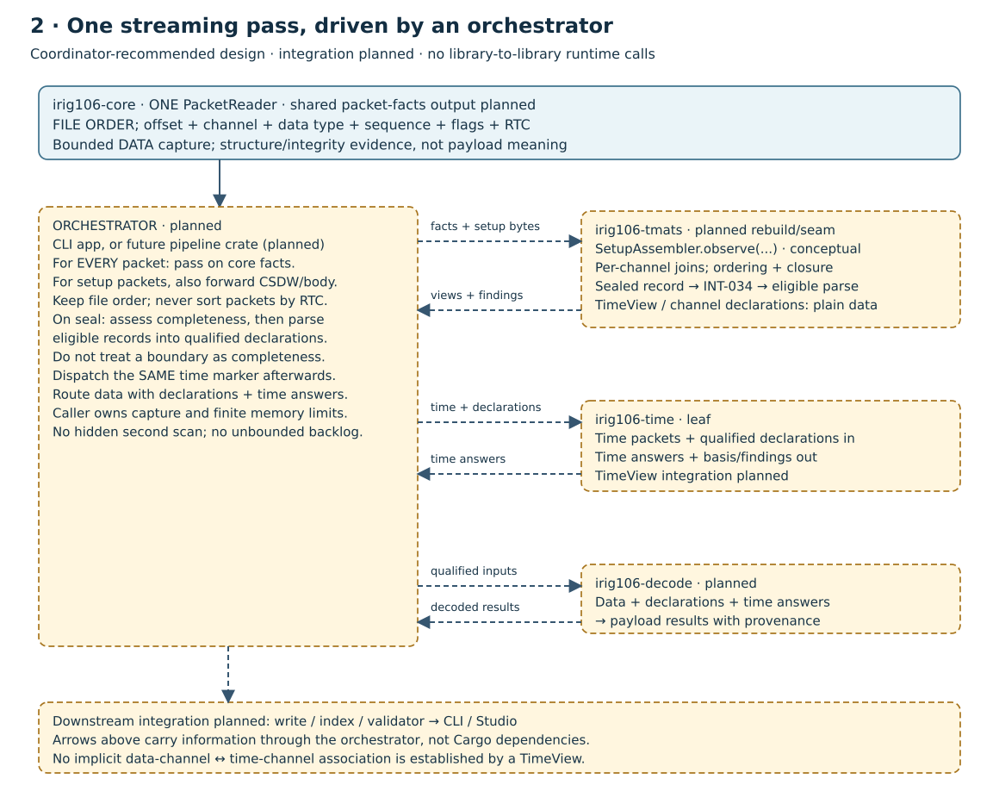

# How the libraries pass information

**Owner-directed architecture, 2026-11-23.** Core 0.1.0 supplies the shared
structural packet reader. The diagrams show the intended ecosystem around it,
not a claim that all integrations are implemented. Every unimplemented consumer,
seam, and orchestration step is labelled **planned**. The older
[implementation snapshot](../implementation.md) remains dated 2026-11-10;
this page does not silently update its historical evidence.

The owner has decided the layer responsibilities, one shared reader, per-channel
setup assembly, initial and mid-recording closure by time packets, and initial
ordering checks. The **coordinator-recommended** one-pass orchestrator is a
planned design. The owner has also decided that the plain packet-facts type lives in
`irig106-types`: core produces the facts, the orchestrator passes them on, and
TMATS consumes them without depending on core. The type and its integration
remain **planned** until implemented.

## 1. Layers and dependencies

[SVG source](diagrams/pipeline-layers.svg) · [PNG export](diagrams/pipeline-layers.png)

The layers are shared values (`irig106-types`), structural reading
(`irig106-core`), meaning (`irig106-tmats`, `irig106-time`, `irig106-decode`),
downstream write/index/validation, and CLI/Studio applications. Dependency arrows
point **from a consumer toward its provider**; they are not the direction of
runtime data flow. Dashed downstream connections show planned consumption, not
newly approved Cargo dependency manifests.

The umbrella `irig106-cli` is intended to mount the time and TMATS CLI libraries
(**planned**). Studio has application code; its integration with this pipeline is
**planned**. `irig106-ch10-reader` is **archived**, outside the target pipeline.
One reader in core is the target: this does not claim every existing consumer
has already removed its duplicate reader.

Time remains a leaf library depending only on types (ADR-0005). The owner-decided
TMATS leaf boundary uses a plain packet-facts type in `irig106-types`
(**planned**). Core produces that shared value, the orchestrator passes it on,
and TMATS consumes it. TMATS stays independent of core; the orchestrator does
not define a competing packet-facts type. No direct TMATS-to-core dependency
is selected. Time gains no dependency on core or TMATS. Static dependencies
and runtime calls are distinct: the recommended orchestration below has no
semantic library call another semantic library to walk the recording.

## 2. A single streaming pass

[SVG source](diagrams/pipeline-flow.svg) · [PNG export](diagrams/pipeline-flow.png)

The **planned orchestrator** lives in a CLI application or a future pipeline
crate. It drives one `irig106_core::PacketReader` in **file order**, retaining byte
offsets. It never sorts by RTC before assembly. For each packet it:

1. Passes on core-produced plain packet facts (shared type in `irig106-types`,
   **planned**): channel, header data type, sequence, flags, offset, RTC, and relevant
   trust/edition evidence to TMATS's **planned** observation seam. For a Format 1
   setup packet, it also supplies that fragment's CSDW and body. `SetupAssembler.observe(...)`
   is conceptual notation here, not a verified callable Rust signature.
2. Lets TMATS track independent per-channel runs, ordering, and closure. On seal,
   TMATS assesses completeness separately (INT-034), parses eligible complete
   records, and returns **planned** bounded `TimeView` / channel declarations as
   plain data with provenance, qualification, and findings.
3. Routes time packets and qualified declarations to time. For a closing time
   marker, observation and setup assessment happen **before** dispatching that
   **same** packet for time interpretation; the marker is never setup text.
4. Routes data packets with qualified declarations and time answers to
   `irig106-decode` (**planned**). Results retain their basis and findings rather
   than inventing missing metadata or an absolute time.

Core checks framing and exposes integrity evidence, not TMATS validity, time
meaning, or complete standard conformance. Its bounded `body_prefix` can be only
part of DATA: the caller must choose explicit capture and aggregate assembler
budgets, detect insufficient capture, and report typed limits. Never parse a
captured prefix as a complete setup body, silently drop fragments, buffer an
unbounded recording, or add a hidden second reader.

The time-view seam is **planned**, gated by ADR-0021 on full TMATS 0.1 release and
owner approval. A TIMEIN declaration does not establish a data-channel to
time-channel association; that relationship remains unresolved without evidence.
Missing, incomplete, ambiguous, or withheld context stays explicit. No automatic
carry-forward or provisional-use policy is invented here.

## 3. Closure is separate from completeness and adoption

[SVG source](diagrams/pipeline-closure.svg) · [PNG export](diagrams/pipeline-closure.png)

**Owner decisions, 2026-11-23:**

- **Join per channel (INT-011).** Other-channel setup fragments never mix with
  or interrupt a run. Preserve sequence progression, FRMT/RCCVER agreement,
  fragment provenance, and start/stop evidence. The channel-0 restriction from
  106-17 is an independent conformance check, not permission to merge runs.
- **Initial closure (INT-045).** The first structurally trusted TIME packet on
  **any channel** closes the initial per-channel setup candidates immediately
  before that marker. Its header data type is `0x11`, or `0x12` where defined
  from 106-17, under the applicable edition binding. Unknown/reserved types and
  timestamps embedded in other packet bodies are not this signal.
- **Mid-recording closure.** The next eligible trusted time packet also closes
  a later setup record, including an update with SRCC=1. This owner decision
  extends the initial-only proposal in the inspected INT-045 draft.
- **Header facts suffice for closure.** No time payload decoding, usable clock,
  UTC answer, or time-source selection is needed to recognize the boundary.
  Header/edition trust still matters; corrupt or unreadable bytes are not a
  trusted marker merely because they resemble a type code.

A sealed run is not automatically complete or governing. INT-034 independently
assesses complete/incomplete/ambiguous outcomes with their evidence; closure
cannot repair truncated text, resolve duplicate/split ambiguity, or choose one
candidate across channels. A valid complete outcome and adoption eligibility
remain separate gates. A live run without a marker remains open/provisional;
actual EOF has its own labelled completeness basis and missing-time finding,
not a fabricated time marker. Detailed INT-034 precedence and provisional
semantic use remain subject to their own reviewed contracts.

## 4. Ordering and caller-asserted start

[SVG source](diagrams/pipeline-ordering.svg) · [PNG export](diagrams/pipeline-ordering.png)

Only **static Computer-Generated Format 1 setup packets** may precede the first
time packet. Any other intervening packet is an ordering violation: record a
finding and withhold adoption through this automatic path. A later time marker
can seal candidates but does not erase the violation. The state diagram's later
SRCC=1 setup is after the initial time boundary, not an exception to the initial
static-prefix rule; SRCC alone neither closes nor proves a complete record.

**Known start is asserted by the caller**, not inferred from a file offset,
a first observed setup packet, or successful sync recovery. Retain that provenance;
unknown/cropped start or untrusted prefix evidence must not silently become a
known clean recording start. Record findings and preserve the bytes when
authoritative automatic adoption is withheld.

## Sources and authority

Source inspection on 2026-11-23; no sibling builds or tests were run for this page.
The owner request of that date is authority for the new closure/ordering decisions
above. The pinned TMATS sources below still call INT-045 an **unapproved,
initial-only proposal**; they do not yet record the owner's new mid-recording
extension. These diagrams document the new direction as **planned**, not as a
shipped assembler or a retroactive change to those source records.

- Core `3c12bcd`: [0.1 API](https://github.com/TelemetryWorks/irig106-core/blob/3c12bcd33b1ae66cca2d6378f4bfe08f2fc8c9a1/docs/api.md)
  and [requirements](https://github.com/TelemetryWorks/irig106-core/blob/3c12bcd33b1ae66cca2d6378f4bfe08f2fc8c9a1/docs/requirements.md).
- Time `5899806`: [architecture](https://github.com/TelemetryWorks/irig106-time/blob/5899806ae684ed38d8cad8f422cabb3d47c6be0f/docs/architecture.md),
  [ADR-0005 leaf boundary](https://github.com/TelemetryWorks/irig106-time/blob/5899806ae684ed38d8cad8f422cabb3d47c6be0f/docs/adr/0005-leaf-library-depending-only-on-irig106-types.md),
  and [ADR-0021 time-view seam](https://github.com/TelemetryWorks/irig106-time/blob/5899806ae684ed38d8cad8f422cabb3d47c6be0f/docs/adr/0021-tmats-release-and-bounded-time-view.md).
- TMATS `0a9f010`: [release/time-view contract](https://github.com/TelemetryWorks/irig106-tmats/blob/0a9f010cdd031bfb967cd21a495924558e9112d7/docs/RELEASE-0.1.md),
  [INT-011](https://github.com/TelemetryWorks/irig106-tmats/blob/0a9f010cdd031bfb967cd21a495924558e9112d7/docs/INTERPRETATIONS.md#int-011),
  [INT-034](https://github.com/TelemetryWorks/irig106-tmats/blob/0a9f010cdd031bfb967cd21a495924558e9112d7/docs/INTERPRETATIONS.md#int-034),
  [INT-045](https://github.com/TelemetryWorks/irig106-tmats/blob/0a9f010cdd031bfb967cd21a495924558e9112d7/docs/INTERPRETATIONS.md#int-045),
  [ADR-0025 assembly](https://github.com/TelemetryWorks/irig106-tmats/blob/0a9f010cdd031bfb967cd21a495924558e9112d7/docs/adr/0025-setup-record-assembly-contract.md),
  and [ADR-0031 completeness](https://github.com/TelemetryWorks/irig106-tmats/blob/0a9f010cdd031bfb967cd21a495924558e9112d7/docs/adr/0031-setup-record-completeness.md).

SVGs are self-contained XML with accessible titles/descriptions and no external
fonts, scripts, or images. The small committed PNGs are rendered from their
matching SVGs using `rsvg-convert --output <name>.png <name>.svg` (librsvg 2.54.7,
DejaVu Sans). Both formats are documentation assets, not a running pipeline.
