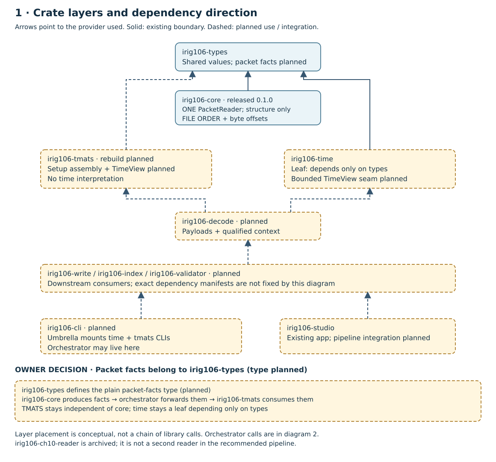

# How the libraries pass information

**Owner-directed architecture, 2026-11-23.** Core 0.1.0 supplies the shared
structural packet reader. The diagrams show the intended ecosystem around it,
not a claim that all integrations are implemented. Every unimplemented consumer,
seam, and orchestration step is labelled **planned**. The older
[implementation snapshot](../implementation.md) remains dated 2026-11-10;
this page does not silently update its historical evidence.

The owner has decided the layer responsibilities, one shared reader, per-channel
setup assembly, initial and mid-recording closure by time packets, and initial
ordering checks. The **coordinator-recommended** one-pass orchestrator is a
planned design. The **owner decision of 2026-11-23** fixes the plain packet-facts type location in
`irig106-types`: core produces the facts, the orchestrator passes them on, and
TMATS consumes them without depending on core. The type and its integration
remain **planned** until implemented.

## 1. Layers and dependencies

[SVG source](diagrams/pipeline-layers.svg) · [PNG export](diagrams/pipeline-layers.png)

The layers are shared values (`irig106-types`), structural reading
(`irig106-core`), meaning (`irig106-tmats`, `irig106-time`, `irig106-decode`),
downstream write/index/validation, and CLI/Studio applications. Dependency arrows
point **from a consumer toward its provider**; they are not the direction of
runtime data flow. Dashed downstream connections show planned consumption, not
newly approved Cargo dependency manifests.

The umbrella `irig106-cli` is intended to mount the time and TMATS CLI libraries
(**planned**). Studio has application code; its integration with this pipeline is
**planned**. `irig106-ch10-reader` is **archived**, outside the target pipeline.
One reader in core is the target: this does not claim every existing consumer
has already removed its duplicate reader.

Time remains a leaf library depending only on types (ADR-0005). The owner-decided
TMATS leaf boundary uses `PacketFacts` (**planned**), a header-facts-only type
in `irig106-types`. The name is diagram notation, not a released API. This
location is decided, not an open option (owner decision, 2026-11-23). Core produces that shared value, the orchestrator passes it on,
and TMATS consumes it. TMATS stays independent of core; the orchestrator does
not define a competing packet-facts type. No direct TMATS-to-core dependency
is selected. Time gains no dependency on core or TMATS. Static dependencies
and runtime calls are distinct: the recommended orchestration below has no
semantic library call another semantic library to walk the recording.

## 2. A single streaming pass

[SVG source](diagrams/pipeline-flow.svg) · [PNG export](diagrams/pipeline-flow.png)

The **planned orchestrator** lives in a CLI application or a future pipeline
crate. It drives one `irig106_core::PacketReader` in **file order**, retaining byte
offsets. It never sorts by RTC before assembly. The owner-approved **planned**
selective dispatch below refines the original all-header forwarding proposal:

1. Classify each packet once from its header data-type byte. Setup packets go
   to TMATS with core-produced plain `PacketFacts` (**planned**), CSDW and body.
   TMATS observes every header **only during the initial setup phase**, so it
   can enforce initial ordering and recognize the first trusted time marker.
   `SetupAssembler.observe(...)` is conceptual notation, not a released API.
2. TMATS tracks independent per-channel candidates. An eligible time marker
   notifies TMATS only while a candidate is open, including a later setup
   candidate. On seal, INT-034 assesses completeness separately; eligible
   parsing produces qualified plain declarations and findings (**planned**).
3. Time packets go to time with the qualified declarations. When a packet also
   closes setup, the cheap header-only marker notification and setup assessment
   precede time interpretation of that **same** packet. Its payload is not
   decoded by TMATS or included in setup text.
4. Data packets go only to decode, with qualified declarations and time answers
   (**planned**). After the initial phase, they are not dispatched to TMATS.
   Missing metadata or time basis remains explicit rather than invented.

Core checks framing and exposes integrity evidence, not TMATS validity, time
meaning, or complete standard conformance. Its bounded `body_prefix` can be only
part of DATA: the caller must choose explicit capture and aggregate assembler
budgets, detect insufficient capture, and report typed limits. Never parse a
captured prefix as a complete setup body, silently drop fragments, buffer an
unbounded recording, or add a hidden second reader.

The time-view seam is **planned**, gated by ADR-0021 on full TMATS 0.1 release and
owner approval. A TIMEIN declaration does not establish a data-channel to
time-channel association; that relationship remains unresolved without evidence.
Missing, incomplete, ambiguous, or withheld context stays explicit. No automatic
carry-forward or provisional-use policy is invented here.

## 3. Closure is separate from completeness and adoption

[SVG source](diagrams/pipeline-closure.svg) · [PNG export](diagrams/pipeline-closure.png)

**Owner decisions, 2026-11-23:**

- **Join per channel (INT-011).** Other-channel setup fragments never mix with
  or interrupt a run. Preserve sequence progression, FRMT/RCCVER agreement,
  fragment provenance, and start/stop evidence. The channel-0 restriction from
  106-17 is an independent conformance check, not permission to merge runs.
- **Initial closure (INT-045).** The first structurally trusted TIME packet on
  **any channel** closes the initial per-channel setup candidates immediately
  before that marker. Its header data type is `0x11`, or `0x12` where defined
  from 106-17, under the applicable edition binding. Unknown/reserved types and
  timestamps embedded in other packet bodies are not this signal.
- **Mid-recording closure.** The next eligible trusted time packet also closes
  a later setup record, including an update with SRCC=1. This owner decision
  extends the initial-only proposal in the inspected INT-045 draft.
- **Header facts suffice for closure.** No time payload decoding, usable clock,
  UTC answer, or time-source selection is needed to recognize the boundary.
  Header/edition trust still matters; corrupt or unreadable bytes are not a
  trusted marker merely because they resemble a type code.

A sealed run is not automatically complete or governing. INT-034 independently
assesses complete/incomplete/ambiguous outcomes with their evidence; closure
cannot repair truncated text, resolve duplicate/split ambiguity, or choose one
candidate across channels. A valid complete outcome and adoption eligibility
remain separate gates. A live run without a marker remains open/provisional;
actual EOF has its own labelled completeness basis and missing-time finding,
not a fabricated time marker. Detailed INT-034 precedence and provisional
semantic use remain subject to their own reviewed contracts.

## 4. Ordering and caller-asserted start

[SVG source](diagrams/pipeline-ordering.svg) · [PNG export](diagrams/pipeline-ordering.png)

Only **static Computer-Generated Format 1 setup packets** may precede the first
time packet. Any other intervening packet is an ordering violation: record a
finding and withhold adoption through this automatic path. A later time marker
can seal candidates but does not erase the violation. The state diagram's later
SRCC=1 setup is after the initial time boundary, not an exception to the initial
static-prefix rule; SRCC alone neither closes nor proves a complete record.

**Known start is asserted by the caller**, not inferred from a file offset,
a first observed setup packet, or successful sync recovery. Retain that provenance;
unknown/cropped start or untrusted prefix evidence must not silently become a
known clean recording start. Record findings and preserve the bytes when
authoritative automatic adoption is withheld.

## 5. Performance design

**Owner approved, 2026-11-23; implementation planned.** These are design targets,
not measured throughput, allocation counts, or capabilities of core 0.1.

### One dispatch per packet (planned)

The orchestrator reads the header's data-type byte **once** for a `match` or jump
table and routes the packet only to the consumer that needs it:

| Packet / phase | Planned route |
| --- | --- |
| Data packets (expected to dominate normal recordings) | Decode only, with qualified declarations and time answers |
| Time packet | Time; additionally a cheap header-only time-marker notification to TMATS **only while a setup candidate is open** |
| Setup packet | TMATS, with CSDW and body |
| Initial setup phase | TMATS also observes every header until the first trusted time boundary, including headers needed to report an ordering violation |

The initial ordering check is the explicit exception to selective data dispatch.
Outside that phase, there is no general per-packet TMATS callback. The header-only
marker notification is not a second payload consumer or a second packet read.
Other unsupported packet types retain explicit handling/findings; they are not
misclassified as supported data. File order, trust and edition checks still apply.

### Small facts and borrowed bodies (planned)

`PacketFacts` is a small **Copy**, header-facts-only value in `irig106-types`,
with a target size of **about 32 bytes** and no heap storage, passed by value or
reference. This is a proposed layout budget, not a verified `size_of` or a
released type. Core produces it; the orchestrator passes it to the selected
consumer without TMATS depending on core.

Payload slices are **borrowed `&[u8]` from one reader buffer**, with no payload
copy between libraries on the synchronous data path (**planned**). A borrow may
not survive reuse or growth of its backing buffer. This does not promise no
kernel-to-user copy, allocation-free setup assembly, or copy-free owned exports.

### Reuse packet storage: planned core 0.2 API

The data path targets **no per-packet allocation after sufficient buffer capacity
has been established**. A reusable grow-on-demand buffer is sized from the
validated header's **Packet Length before reading the body**, subject to the
caller's explicit maximum. Check lengths, overflow and the cap before reserving
storage. Growth may allocate when a larger permitted packet first arrives;
subsequent packets reuse that capacity. Storage follows the largest accepted
packet's capacity high-water mark, not the recording's byte count. There is no
whole-file buffering or unchecked allocation from a wire length.

**Current core 0.1 differs:** its
[reader implementation](https://github.com/TelemetryWorks/irig106-core/blob/3c12bcd33b1ae66cca2d6378f4bfe08f2fc8c9a1/crates/irig106-core/src/reader.rs)
creates an owned `Vec` capture per packet and reserves the requested DATA prefix
(nonzero capture can allocate). Its bounded `body_prefix` is not the planned
reusable borrowed-payload API. No core code or public API changes are made here.

### Ordered reader, bounded worker fan-out (planned)

Keep **one ordered reader**: setup closure, initial ordering and time-reference
updates stay on the ordered path. Fan out per **channel** to workers through
bounded channels, preserving order within each channel. Do not let worker
completion reorder the observations used for setup and time context.

A **fixed-size buffer pool** supports ownership transfer: the reader fills a
pool buffer, moves ownership to a worker, and receives the buffer back after use.
A worker borrows payload slices from the buffer it owns; a borrowed slice alone
cannot outlive that buffer. This extends the synchronous one-buffer design
without copying payloads between libraries. When the pool/queues are full, use
backpressure rather than allocating more buffers. Pool payload storage is bounded
by **pool size × maximum packet capacity**, plus fixed metadata and separately
bounded queue, assembler, and worker state; this is not a whole-process RSS claim.

Time correlation stays on the ordered path. Time-reference updates are expected
to be cheap and around **1 Hz per time channel**, not necessarily once per second
for the whole recording. That is a design expectation, not a measured CPU cost or
an enforced rate cap; data-time answer queries can be much more frequent.

### Measure before claiming a speedup (planned)

Add reproducible **throughput** and **allocations-per-packet** benchmarks and a
CI regression gate, following the existing RSS-regression approach. Cover steady
state separately from first-packet/growth allocations, varying packet sizes,
setup/time transitions, channel count and pool backpressure. Report hardware,
fixtures, capture/validation settings, capacity limits and allocation accounting.
The current core RSS test does not prove any of these new targets. No throughput
result, zero-allocation measurement, or performance CI gate is claimed here.

## Sources and authority

**Decision citation — owner, 2026-11-23, assignment update:** “the plain
'packet facts' type lives in irig106-types”. The same owner update specifies
that core produces the facts, the orchestrator passes them on, and TMATS consumes
them while staying independent of core. This is the authority for the decided
boundary above; the type remains planned until implemented.

Source inspection on 2026-11-23; no sibling builds or tests were run for this page.
The owner request of that date is authority for the new closure/ordering decisions
above. The pinned TMATS sources below still call INT-045 an **unapproved,
initial-only proposal**; they do not yet record the owner's new mid-recording
extension. These diagrams document the new direction as **planned**, not as a
shipped assembler or a retroactive change to those source records.

- Core `3c12bcd`: [0.1 API](https://github.com/TelemetryWorks/irig106-core/blob/3c12bcd33b1ae66cca2d6378f4bfe08f2fc8c9a1/docs/api.md)
  and [requirements](https://github.com/TelemetryWorks/irig106-core/blob/3c12bcd33b1ae66cca2d6378f4bfe08f2fc8c9a1/docs/requirements.md).
- Time `5899806`: [architecture](https://github.com/TelemetryWorks/irig106-time/blob/5899806ae684ed38d8cad8f422cabb3d47c6be0f/docs/architecture.md),
  [ADR-0005 leaf boundary](https://github.com/TelemetryWorks/irig106-time/blob/5899806ae684ed38d8cad8f422cabb3d47c6be0f/docs/adr/0005-leaf-library-depending-only-on-irig106-types.md),
  and [ADR-0021 time-view seam](https://github.com/TelemetryWorks/irig106-time/blob/5899806ae684ed38d8cad8f422cabb3d47c6be0f/docs/adr/0021-tmats-release-and-bounded-time-view.md).
- TMATS `0a9f010`: [release/time-view contract](https://github.com/TelemetryWorks/irig106-tmats/blob/0a9f010cdd031bfb967cd21a495924558e9112d7/docs/RELEASE-0.1.md),
  [INT-011](https://github.com/TelemetryWorks/irig106-tmats/blob/0a9f010cdd031bfb967cd21a495924558e9112d7/docs/INTERPRETATIONS.md#int-011),
  [INT-034](https://github.com/TelemetryWorks/irig106-tmats/blob/0a9f010cdd031bfb967cd21a495924558e9112d7/docs/INTERPRETATIONS.md#int-034),
  [INT-045](https://github.com/TelemetryWorks/irig106-tmats/blob/0a9f010cdd031bfb967cd21a495924558e9112d7/docs/INTERPRETATIONS.md#int-045),
  [ADR-0025 assembly](https://github.com/TelemetryWorks/irig106-tmats/blob/0a9f010cdd031bfb967cd21a495924558e9112d7/docs/adr/0025-setup-record-assembly-contract.md),
  and [ADR-0031 completeness](https://github.com/TelemetryWorks/irig106-tmats/blob/0a9f010cdd031bfb967cd21a495924558e9112d7/docs/adr/0031-setup-record-completeness.md).

SVGs are self-contained XML with accessible titles/descriptions and no external
fonts, scripts, or images. The small committed PNGs are rendered from their
matching SVGs using `rsvg-convert --output <name>.png <name>.svg` (librsvg 2.54.7,
DejaVu Sans). Both formats are documentation assets, not a running pipeline.
